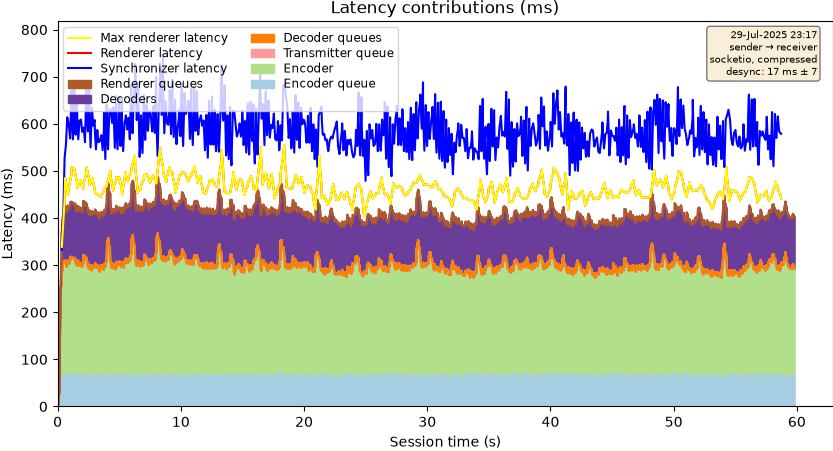

# VRTstatistics: measuring social XR experiments

Status: draft, 2026-11-10. Points for a few slides at the Amplify project meeting (for Pablo), and the seed of a later paper about VRTstatistics.

The first part is the slide material. The "Background material" part is for the paper later, and for answering questions; it isn't meant for the slides.

## Goals

- Measurements of multi-user multi-machine XR experiences
- Very low complexity and runtime impact
- Rich end-to-end results, down to individual events when needed

## Data Recording

- Lines of the form
  
	```
	stats: seq=23, ts=57386.256, component=OrchestratorController, orchestrator_ntptime_ms=1783605386227, localtime_behind_ms=-28, uncertainty_interval_ms=23
	stats: seq=114, ts=57397.075, component=VoicePipelineOther#1, encoded=True, reader=AsyncSocketIOReader, decoder=AsyncVoiceDecoder, preparer=AsyncVoicePreparer#0, synchronizer=none
	stats: seq=237, ts=57398.367, component=AsyncVoicePreparer#0, fps=62.69, fps_dropped=0.00, fps_nodata=24.11, samples_per_frame=960
	```
- Recorded locally
- Granularity set by the experimenter, per experiment
  - Aggregated (e.g. every 10 s): overall statistics, negligible runtime impact
  - Per event: every frame or voice packet, so you can see where each one spent its time
- Records clock relationship to other clocks in the whole system
- Records relationship between components
- Records can be extracted from a general log
  - Because of `stats:` marker and `key=value,` fixed format

## Data Gathering

- Gathered from multiple sources afterwards
- Mapped to unified timeline
  - Using clock relationship records
- Combined into unified "database"
- Annotate records
  - Using component relationship records
  - Create roles `p2.voice.preparer` from implementation detail `AsyncVoicePreparer#0`

## Analysis

- Select records (_all voice going from p1 to p2_)
- Project to a table (_keep only columns latency and drops_)
- Plot or analyse (Pandas, CSV export)

## Example



- End-to-end latency for point clouds, from sender capture to receiver display
- Plus information on where that latency comes from
- And what was measured, with which uncertainty

## Track record

- System experiments (latency, framerate, bandwidth) since the VR2Gather paper (Viola et al., IEEE MultiMedia 2023); later also user studies (gaze, speech, questionnaires).
- Used for a new transport by a partner: WebRTC SFU benchmarking with Ghent University (De Fré et al., NOSSDAV 2026).

# Background material

Not for the slides. Collected for the paper, and for questions at the meeting.

## Current implementation

- Three Python packages, open source (github.com/cwi-dis/VRTstatistics):
  - `VRTstatistics`: parses the logs, aligns the clocks, merges the machines into one dataset (`combined.json`), and produces plots and CSV tables.
  - `VRTrun` and `VRTrunserver`: remote control. One command on a laptop uploads per-machine configs, starts the application on all machines, and collects all logs into one run directory. A convenience, separate from the method.
- The only producer so far is VR2Gather: its components write `stats:` lines with one call (`Statistics.Output(...)` in cwipc_unity), and application-specific components can add their own lines the same way.

## What it measures today

- **System-oriented**: per-frame end-to-end latency and its contributions (capture, encode, transmit, decode, render queues), framerates and dropped frames, point counts, CPU, memory and bandwidth.
- **User-centric**: gaze targets, speech activity and turn-taking, movement and position, scene structure of the experience, participant numbers linked to questionnaire responses.
- **Demos and exhibitions**: start and stop a multi-machine setup from one laptop; timestamped logs for finding out afterwards what went wrong.

## How an experiment is organised

- One directory per experiment, one subdirectory per variant, several runs per variant.
- Variants are hand-written configs: each one has to be justified before it's run, which keeps the paper's story clear.
- Prerecorded replay: record one live session (point clouds, movement, gaze), check that replay gives the same numbers as live, then sweep all variants unattended overnight with identical input.
- Per-experiment analysis lives in the experiment's own repo (`vrts_<experiment>.py`): plain Python on top of VRTstatistics, no fork needed.
- Fail fast: malformed or implausible data should be reported at ingest time, not discovered at analysis time. (The principle is decided; the ingest checks are on the `39-trolley-backport` branch, not yet released.)

## Track record, with references

- Viola et al., "VR2Gather: a collaborative social VR system for adaptive multi-party real-time communication", IEEE MultiMedia 2023 (doi:10.1109/MMUL.2023.3263943): the instrumentation requirement ("instrumentation data for all instances of the pipeline within a session can be combined for analysis") and the clock-aligned, per-frame latency method.
- De Fré et al., "WebRTC-Based Volumetric Video Conferencing: SFU Architecture Evaluation and Benchmarking", NOSSDAV 2026 (doi:10.1145/3798065.3798070): latency contributions over a WebRTC SFU, 10 runs per condition, prerecorded replay. The paper doesn't name VRTstatistics; its Figure 3 matches `plot_latencies()` output. To confirm with the authors before claiming it.
- TrolleyExperiment: a two-participant user study (gaze, speech, questionnaires); its analysis tooling is being folded back into VRTstatistics (VRTstatistics#39).
- Regression testing of VR2Gather itself: a reference dataset covering all protocol and topology combinations.
- Jansen et al., "Open-Sourcing VR2Gather", ACM MM 2024 (doi:10.1145/3664647.3685515): doesn't mention measurement; not a reference for this.

## Current limitations

- Only one producer of records so far (VR2Gather).
- The remote control assumes participant machines run Windows; Mac and Linux work but take extra setup.
- VRTrunserver is meant for a closed lab network: anyone who can reach it can run programs (VRTstatistics#46).
- The user-centric tooling is on a branch, not yet released (VRTstatistics#39).
- Documentation of the analysis layer is still thin.

## Paper seeds

- Contribution: a method for measuring multi-user, multi-machine XR experiences (record, gather, analyse), plus the tool that implements it.
- Design points to explain: the record format and why it's so simple (low runtime impact), granularity chosen by the experimenter (`Statistics.cs` in cwipc_unity: 10 s aggregation by default, set per session; 0 means per event; a component can take its own interval; not checked yet whether a VR2Gather config can set that per component), the unified timeline, annotation from implementation names to roles, the database-style selection and projection, per-experiment modules, fail-fast validation.
- Evaluation: the case studies above; a second producer (such as the Amplify WebXR use case) would show that the method doesn't depend on VR2Gather.
